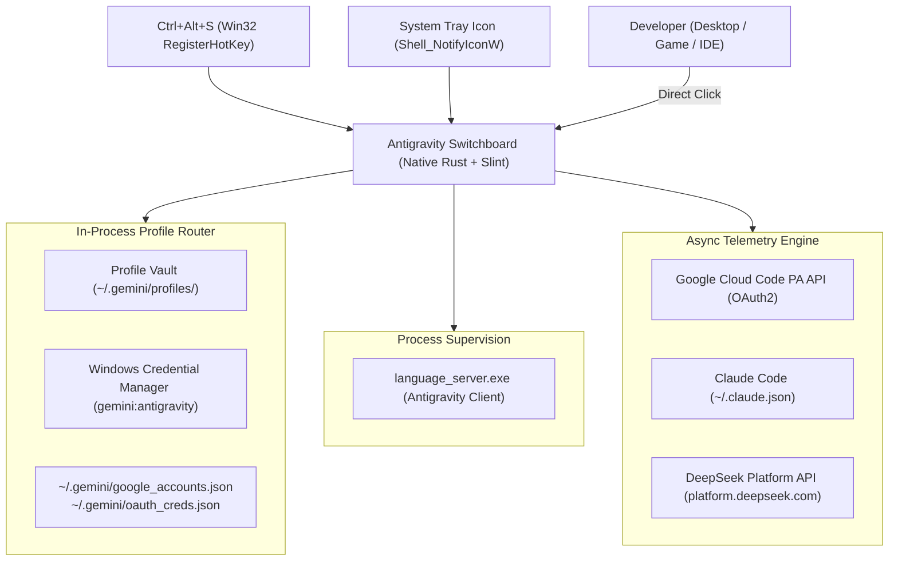

# Antigravity Switchboard v2.0.0

[](https://www.microsoft.com/windows)
[](https://www.rust-lang.org/)
[](https://slint.dev/)
[](https://antigravity.google/)
[](LICENSE)

A hyper-light, native Windows desktop switchboard and quota telemetry dashboard for developers operating across multiple **Google AI Pro / Antigravity** accounts, **Claude Code**, and the **DeepSeek Harness** platform.

**Antigravity Switchboard v2.0.0** is written entirely in pure native **Rust + Slint**, completely eliminating legacy WebViews, Edge/Chromium runtimes (`msedge.exe`), Python venvs, and localhost HTTP servers.

---

## 🚀 Key Features

* **⚡ Pure Native Rust + Slint Desktop Architecture**:
  - Standalone binary (`antigravity-switchboard.exe`, ~19 MB) with sub-10ms cold start and <20 MB working set memory.
  - Zero WebView2, zero Chromium, zero Edge processes, zero Python dependencies.
  - Runs completely windowless without console popups (`windows_subsystem = "windows"`).
* **⌨️ Global Hotkey (`Ctrl+Alt+S`)**:
  - Registered globally via Win32 `RegisterHotKey` in a dedicated OS message pump thread.
  - Instantly toggles or brings the Switchboard to the foreground over full-screen apps and IDEs.
* **🛎️ Native System Tray (`Shell_NotifyIconW`)**:
  - Embedded application icon in Windows Taskbar Notification Area.
  - Left-click to toggle window visibility.
  - Right-click context menu: **Show Switchboard**, **Refresh Quotas**, and **Exit**.
  - Clicking window `[X]` minimizes cleanly to the system tray instead of killing the background supervisor.
* **🔒 Single-Instance Kernel Synchronization**:
  - Enforced via Windows named kernel mutex (`Global\AntigravitySwitchboardV2_SingleInstance`).
  - Automatically restores and brings the existing window to the foreground if launched again.
* **⚡ Sub-15ms Profile Swapping & Process Supervision**:
  - Atomic file-swapping across `~/.gemini/profiles/` and live configuration files using Windows `MoveFileExW` semantics.
  - Direct Windows Credential Manager integration via `advapi32.dll` (`CredWriteW` / `CredReadW`) targeting `gemini:antigravity`.
  - Automatically restarts `language_server.exe` to immediately pick up newly activated credentials. Deprecated "IDE restart" logic has been purged.
* **📊 Live Multi-Provider Telemetry**:
  - **Google Cloud Code PA API**: Direct authenticated requests to `https://cloudcode-pa.googleapis.com/v1internal:retrieveUserQuotaSummary` and `loadCodeAssist` with automatic OAuth2 token refresh and local `LanguageServerService` IPC fallback. Displays dual 5-hour rolling limit and weekly quota caps with live countdowns.
  - **Claude Code**: Inspects `~/.claude.json` and `~/.claude/.credentials.json` for rate limit tiers (e.g. `Claude Max (20x)`, `Claude Pro`) and project token usage.
  - **DeepSeek Platform**: Reads `~/.dsh/.credentials.yaml` and queries `platform.deepseek.com` for account balances and spend metrics.
* **⏱️ 10-Minute Auto-Refresh**:
  - Automated asynchronous background telemetry synchronization scheduled every 600 seconds.

---

## 🛠️ Architecture Overview



---

## 📦 Building & Running

### Prerequisites
- Windows 10 or Windows 11
- Rust toolchain (`stable-x86_64-pc-windows-gnullvm` or `stable-x86_64-pc-windows-msvc`)

### Build
```powershell
# Development build & test verification
cargo test --all-targets

# Optimized standalone release build
cargo build --release
```

The compiled release executable will be generated at:
`target\release\antigravity-switchboard.exe`

### Running
Double-click `antigravity-switchboard.exe` or use the Desktop shortcut `Antigravity Accounts.lnk`.
Press `Ctrl+Alt+S` at any time to toggle the dashboard.
Right-click the system tray icon to access quick actions or exit.

---

## 🧪 Automated Test Suite
Antigravity Switchboard includes 25 hermetic unit and integration tests:
```powershell
cargo test --release
```
* `unittests src\main.rs`: Claude model usage aggregation, tier labels, DeepSeek token extraction & spend formatting.
* `test_google_api`: OAuth XOR credentials decoding, ISO 8601 countdown parser, tier resolution, quota summary mock, and live LanguageServer IPC.
* `test_router`: Email extraction from JWT blobs, sanitization, profile path discovery, and atomic profile swapping.
* `test_hotkey`: Single-instance mutex acquisition & lifecycle, non-existent window handling, and hotkey loop termination.
* `test_tray`: TrayEvent variants, shell notification creation, lifecycle drop, and message dispatch.

---

## 📄 License
MIT License. Copyright (c) 2026 Antigravity Swarm.
